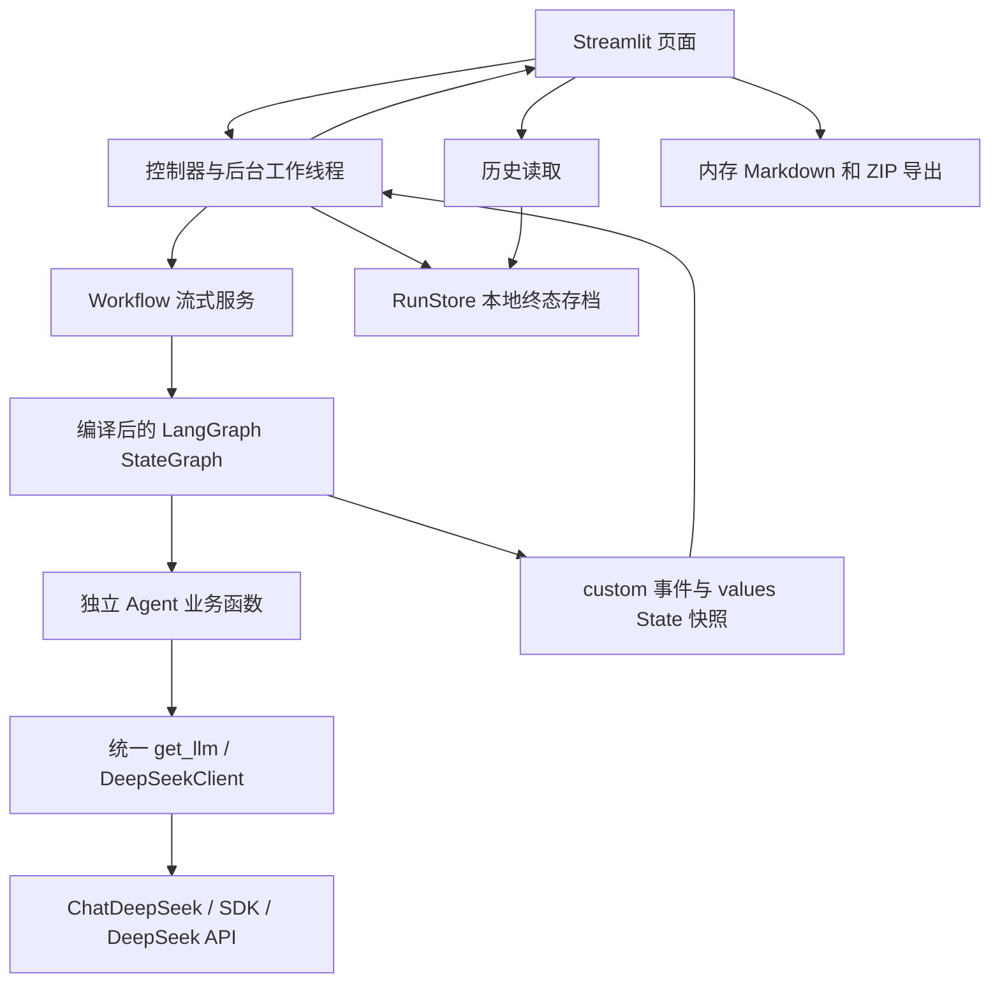

# Multi-Agent Workflow Studio

基于 Python、LangChain、LangGraph 与 DeepSeek API 的多 Agent 软件开发工作流。输入自然语言需求，系统按顺序完成需求分析、系统设计和代码生成；可选加入代码审查与有限修复，通过 Streamlit 展示执行过程并下载结果。

本文描述当前实现。默认交付代码与测试文本；另有显式开启的容器固定验收，无可用隔离后端时不执行，不会在宿主运行生成代码。

## 项目目标

将自然语言需求转换为结构化需求、系统设计和代码文件，通过可观察的工作流、可选代码审查与有限修复，支持小型软件项目的原型交付。

## 文档导航

- [整体架构与模块职责](docs/architecture.md)
- [Workflow、条件分支与 State 示例](docs/workflow.md)
- [四个 Agent 的设计](docs/agent_design.md)
- [测试与验收指南](docs/testing.md)

## 技术栈

版本来自当前 pyproject.toml，直接依赖固定版本；传递依赖没有完整锁文件。

| 组件 | 版本/要求 | 作用 |
| --- | --- | --- |
| Python | >=3.11,<4 | 运行环境；本机实际验证为 3.14.6 |
| LangChain | 1.4.3 | Prompt、消息和模型抽象 |
| LangGraph | 1.2.14 | StateGraph、节点、状态合并和条件循环 |
| langchain-deepseek | 1.1.1 | ChatDeepSeek 适配器 |
| OpenAI SDK | 3.26.0 | 适配器底层 HTTP 调用、异常与有限重试 |
| Streamlit | 1.65.0 | 中文 Web 界面 |
| Pydantic | 2.13.5 | 配置与结构化数据校验 |
| python-dotenv | 1.2.4 | 读取 .env |
| pytest | 9.1.1（dev） | 离线自动化测试 |

## 已实现功能

- Requirements、Design、Coding 三个 Agent，通过共享 State 传递经过校验的数据。
- 新需求保存稳定 FR/AC 编号、原文引用及验收关联；Design 使用持久编号，兼容读取旧需求记录。
- 可选 Review Agent；审查未通过时按预算修复，最多配置 0–3 次，默认一次。
- Review v2 提供分级问题、代码引用及版本绑定；程序静态门禁阻止带 blocker/major 的结果通过，需求/设计问题停止自动代码修复。
- 全局预算限制模型逻辑调用、HTTP 尝试、格式修复、节点次数和总时限；支持请求停止、部分结果保存及可选 token 核算/重复问题阈值。
- 可选 SQLite checkpoint：保存阶段进度、等待需求澄清、重启后继续；失败节点重试和审查反馈修订采用关联的新尝试，继承累计预算。
- 独立隔离验证服务：固定镜像、禁网、非特权、只读产物和资源限额；10 个版本化评测任务，独立保存证据，区分通过、用例失败、基础设施错误、超时与未运行。
- 审查修复使用带基线/反馈摘要的按文件补丁，默认只替换已有文件；程序合并并重验完整产物，保留未修改文件与原运行说明。时间线和报告展示修复路径及字节指标。
- 同步、异步工作流入口及阶段事件流；节点开始、完成、失败、耗时、State 读写字段和可获得的 token usage。
- 中文任务输入、三个示例、进度卡、结果 Tabs、单节点详情、审查和修复历史。
- 思考模式开关：默认读取 .env，仅覆盖本次任务，不改写文件，不影响其他会话。
- 本地 UTF-8 JSON 终态结果保存、部分结果保存、历史列表与按 run_id 打开。
- Requirements.md、Design.md、代码 ZIP、WorkflowReport.md 下载。
- 分类错误提示、有限重试、脱敏技术日志、安全路径及文件大小限制。

## 系统架构



标准模式：START → Requirements → Design → Coding → END。
审查模式：Coding → Review；通过结束，未通过且有预算则返回 Coding，预算耗尽以 completed_with_issues 结束。调用异常以 failed 停止，不伪装为审查未通过。

State 中保存业务数据和事件，不保存 API Key。Agent 返回部分更新，合并由 LangGraph channel/reducer 完成。详见 [工作流文档](docs/workflow.md)。

## 环境安装

从项目根目录执行以下 PowerShell 命令。安装依赖需要网络，但以下初始化与普通测试不调用 DeepSeek。

```powershell
py -3.11 -m venv .venv
.\.venv\Scripts\python.exe -m pip install --upgrade pip
.\.venv\Scripts\python.exe -m pip install -e ".[dev]"
.\.venv\Scripts\python.exe -m pip check
```

若未安装 Python 3.11，可使用已安装的兼容 Python 创建虚拟环境；本机用 Python 3.14.6 测试，未声称已逐一实测所有支持版本。使用虚拟环境解释器完整路径，无需执行激活脚本。

## DeepSeek API 配置

项目已有 .env 时直接编辑，不覆盖现有密钥。仅首次且文件不存在时复制：

```powershell
if (-not (Test-Path -LiteralPath .env)) {
    Copy-Item -LiteralPath .env.example -Destination .env
}
```

填写本地 .env，不把真实密钥写入源代码、聊天或版本控制：

```dotenv
DEEPSEEK_API_KEY=在本地替换为你的密钥
DEEPSEEK_BASE_URL=https://api.deepseek.com
DEEPSEEK_MODEL=deepseek-flash
DEEPSEEK_TEMPERATURE=0.2
DEEPSEEK_TIMEOUT=300
DEEPSEEK_MAX_RETRIES=2
DEEPSEEK_THINKING=disabled
```

| 配置 | Settings 默认值 | 说明 |
| --- | --- | --- |
| DEEPSEEK_API_KEY | 无 | 安装/离线测试不要求配置，真实调用要求非空 |
| DEEPSEEK_BASE_URL | https://api.deepseek.com | HTTP 服务地址 |
| DEEPSEEK_MODEL | deepseek-flash | 可修改；模型须支持相应调用能力 |
| DEEPSEEK_TEMPERATURE | 0.2 | 范围 0–2 |
| DEEPSEEK_TIMEOUT | 60 | 有限正数、秒；示例文件为代码生成配置 300 |
| DEEPSEEK_MAX_RETRIES | 2 | 范围 0–5，首次请求之外的重试次数 |
| DEEPSEEK_THINKING | disabled | enabled 或 disabled |

优先级：Settings 默认值 < 指定 .env < 进程环境变量。默认 .env 路径相对于当前工作目录，所以应从项目根目录启动。读取不会修改 os.environ，不向父目录搜索，不展开 dotenv 变量插值。

Web 思考开关首次读取上述默认值，之后保留会话选择；提交时覆盖本次任务全部 Agent 调用。运行中的任务不能切换。新任务读取新配置，已经创建的客户端不会中途更新。

项目按官方接口通过 extra_body.thinking.type 传入思考开关。思考模式可能增加等待时间，关闭可能影响输出质量，不承诺加速比例。[DeepSeek 官方说明](https://api-docs.deepseek.com/guides/thinking_mode/)

## 启动方式

```powershell
# 离线配置检查：不会发送模型请求，也不会启动页面
.\.venv\Scripts\python.exe -m workflow_studio

# Web 页面
.\.venv\Scripts\python.exe -m streamlit run app.py
```

浏览器通常访问 http://localhost:8501，以 Streamlit 终端输出为准。无 Key 时可以查看历史；启动新 Workflow 按钮禁用。

## 使用示例

1. 在主区域底部输入面板填写至少 10 字符的开发需求，或通过“示例”选择预置任务。
2. 通过输入面板的“设置”调整思考、审查、保存进度及运行预算；首次演示建议标准模式、关闭思考。
3. 需要审查时勾选“开启代码审查”，配置最大修复次数；0 表示审查但不修复。
4. 点击“发送”才启动任务并产生 API 请求。启动后显示进度、时间线与结果；运行时输入锁定，可点击“停止”。
5. 终态结果的“验证与下载”默认收起，展开后可下载文档与代码 ZIP，或显式选择独立隔离验证。保存失败可“仅重试保存”。
6. 左侧“历史运行”和“已保存的进度”按需展开；重绘、切换详情和下载不会重新调用 API。空白页面仅显示引导，不展示等待中的进度卡。

最小需求示例：

> 使用 Python 标准库开发两个整数相加的命令行工具，提供基本 unittest 测试和运行说明，不使用数据库或网络。

Python 业务入口也可调用（下例会产生真实 API 请求，不属于离线检查）：

```python
from workflow_studio.workflows import run_workflow

result = run_workflow("使用 Python 标准库开发整数加法工具，提供基本测试和运行说明。")
print(result.run_id, result.status)
```

runner 不自动写磁盘。需要时对已有 result 显式调用 RunStore.save；方法签名和示例见架构文档。

## 测试命令

```powershell
.\.venv\Scripts\python.exe -X utf8 -m pytest -q
.\.venv\Scripts\python.exe -m pip check
.\.venv\Scripts\python.exe -m compileall -q src tests app.py
```

普通 pytest 使用 Mock、固定数据及真实本地测试图/临时文件，不产生模型费用。符号链接测试可能因系统权限跳过。完整测试说明见 [testing.md](docs/testing.md)。

以下两条需显式执行，会调用真实 API，可能产生费用；本次文档核对没有执行：

```powershell
.\.venv\Scripts\python.exe -X utf8 -m workflow_studio.llm.smoke_test --run
.\.venv\Scripts\python.exe -X utf8 -m workflow_studio.workflows.integration_test --run
```

## 常见问题

**为什么 Coding Agent 很慢？** 三个阶段有输入依赖，耗时累加；代码输出长、开启思考、SDK 重试、JSON 修复、审查循环都会增加等待。先使用小需求、关闭思考及审查，查看节点详情中的实际耗时和调用次数。300 秒超时是等待设置，不是加速设置，也不是整节点硬性 deadline。

**开关会改写 DEEPSEEK_THINKING 吗？** 不会。它只覆盖提交任务的上下文。新会话仍读取 .env 默认值。旧历史没有保存思考设置，不从当前开关推断历史模式。

**为什么已配置仍认证失败？** “已配置”只表示 Key 非空，不表示 API 已验证。401/403 不重试；检查账户权限和进程环境变量是否覆盖 .env。

**如何处理限流、超时和格式错误？** SDK 对合适的瞬态错误有限重试；Agent 对结构错误进行有界修复。预算用尽终止，失败节点之后不继续执行。不会无限重试，也不自动重跑整图。

**审查通过是否代表代码正确？** 不代表。生成阶段使用 ast.parse 检查语法，LLM 审查是静态意见。可显式运行独立固定验收，但通过仅覆盖所选接口和用例，不证明完整自然语言需求已实现；生成代码自带的测试不作为可信验收集。

**结果存在哪里？** 项目根目录 outputs/{run_id}/；固定 JSON 文件、UTF-8 编码。失败时已完成阶段保留，缺失阶段为 null。review.json 仅在启用审查时存在。技术日志在 logs/workflow_studio.log。相关目录已忽略提交。

**保存失败或历史损坏怎么办？** 保存失败不改变业务终态，当前结果仍可下载；确认目录权限/磁盘空间后只重试保存。损坏记录会被跳过，打开失败不替换当前结果。不要把输出目录指向源码目录或链接目录。

**导出有哪些限制？** 最多 20 个文件、每文件 64 KiB、CodingOutput 总计 256 KiB；ZIP 512 KiB、单份 Markdown 2 MiB；持久化 JSON 每文件 4 MiB、每运行 8 MiB、事件最多 512 条。拒绝路径穿越、绝对路径、敏感文件、重名及文件/目录冲突，不解压到源码目录。

## 已知限制

- 默认模式保存终态结果；勾选“保存进度并支持澄清”后另存 checkpoint 到 `checkpoints/workflows.sqlite3`。侧栏打开进度仅读取，继续或提交澄清才推进。恢复可能重放未提交节点，不保证外部调用恰好一次；同步在途调用仍不能立即强制中断。
- 页面是阶段事件流，没有 token 逐字输出；进度按节点状态统计，修复时可能回退，并非耗时估计。
- 本地历史没有账户隔离、加密、备份管理或跨进程写协调。摘要用于损坏检测，不是防篡改签名；业务需求与代码会按要求保存在本地。
- 未发布的 .pending-* 目录保留供排查，没有自动清理。刷新/断开可能失去运行中会话，后台调用可能继续完成。
- 同步 LLM 包装器未提供独立 ainvoke；工作流有 arun_workflow，LangGraph 会在线程执行器中运行同步节点。
- 语义正确性和约束实际遵守程度无法仅靠 Schema 证明；固定验收目前只支持标准库 Python JSON CLI，不安装第三方依赖，不执行任意 shell 或自动推断完整需求覆盖。容器后端需要另外部署并验证，当前主机未检测到 Docker。
- SDK 重试策略使用固定版本的 _should_retry / _prepare_request 钩子；升级 SDK 需要重跑策略与适配测试。没有全量依赖锁文件。

## 隔离验证与固定评测

任务结束后，在“隔离验证与固定验收”选择与产物接口一致的契约，再点击“验证当前产物（隔离）”。默认入口为 `main.py`，从 stdin 接收一个 JSON 对象，向 stdout 输出一个 JSON 对象。错误接口、第三方依赖或人工验收任务不会自动获得通过结论。

管理员需预装可信、无声明卷的标准库 Python Linux 镜像，从其 `RepoDigests` 复制完整值到 `.env` 的 `WORKFLOW_VALIDATION_IMAGE`（进程环境优先）。只接受 `repository@sha256:...`，拒绝浮动 tag；运行不会拉取镜像。首版使用本机 Docker 默认 socket/Windows named pipe，拒绝远程 DOCKER_HOST 与用户 context；预检必须确认 Linux、seccomp 和资源限制可用。

```powershell
# 仅读取固定契约目录，不执行代码或调用模型
.\.venv\Scripts\python.exe -m workflow_studio.validation --list

# 显式执行：评测目录放置 <suite-id>.json，内容为完整 CodingOutput
.\.venv\Scripts\python.exe -m workflow_studio.validation --evaluate .\eval-candidates --run

# 可选真实容器回归；需要事先配置可用镜像和本机 Docker
$env:WORKFLOW_VALIDATION_INTEGRATION = '1'
.\.venv\Scripts\python.exe -m pytest tests/test_validation_runtime.py -q
```

独立报告保存在 `artifacts/validation/{run_id}/{report_id}.json`，可从页面下载 JSON/Markdown，重开终态历史可读取已有报告。报告绑定代码、需求/设计上下文、验收集摘要和镜像身份；原 Workflow 终态与存档不会被改写。详细协议、预算与部署限制见 [工作流](docs/workflow.md)和[架构](docs/architecture.md)。

## 增量文件修复

首次生成仍交付完整 CodingOutput。审查模式进入修复时，模型只提交变更文件的完整内容，不能用全量重生成覆盖未提及文件。补丁必须匹配当前代码、需求/设计和反馈版本，引用已知问题；默认不允许新增、删除、改名或修改依赖/运行说明。高级调用方可用 `RepairPolicy` 明确列出新增/删除路径，合并结果继续接受原有路径、文件数、大小和 Python AST 校验。

“增量”描述输出协议，输入仍保留完整需求、设计接口与全部基线文件。时间线中的规范化补丁/完整产物字节对比不等于实际 Token 或费用节省；真实用量继续以服务返回的遥测为准。未验证的文件替换不会直接标为修复成功，审查模式仍需再次 Review。

开发者可显式调用 `validation.repair.repair_and_validate` 执行“固定验收 → 增量修复 → 新版固定验收”，继承源预算与剩余修复次数，发现回归即停止；没有隔离后端时不请求模型修复。该入口会调用模型与容器，不由普通页面或评测 CLI 自动触发。容器端到端效果仍待实际部署验证，接口与用法见 [工作流文档](docs/workflow.md)。
