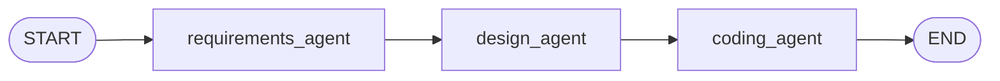
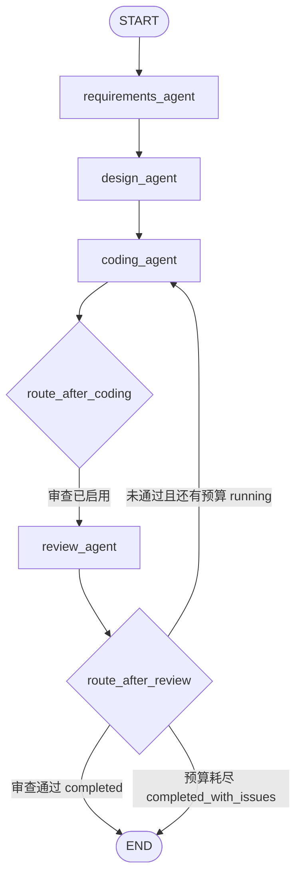
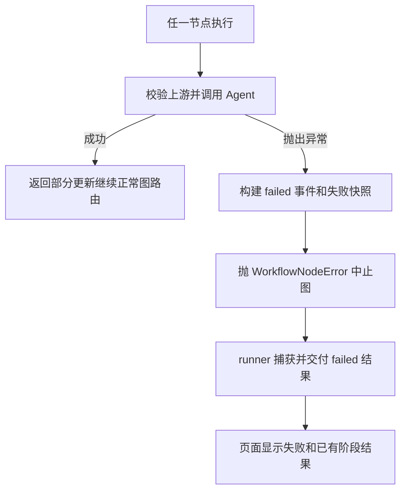

# Workflow 与 State

实现文件：src/workflow_studio/workflows/{graph,nodes,routing,runner}.py、state/{workflow,result,review}.py。

## 标准模式



build_workflow(review_enabled=False) 创建 StateGraph(WorkflowState)，用 add_node 注册三个节点、add_edge 顺序连接，再 compile。标准图不注册 Review 节点，不调用 Review Agent。

## 审查模式



本图对应 build_workflow(review_enabled=True)。菱形是 add_conditional_edges 使用的路由函数，不是额外注册的 Agent 节点。route_after_coding 在审查图正常运行时指向 Review；源码还映射 __end__ 到 END，以处理 review_enabled=False 的路由返回值，但公开 runner 会使用一致的构图/State 参数。

route_after_review 先检查终态；completed 或 completed_with_issues 返回 __end__。否则必须为 needs_revision 且 revision_count < max_revisions，才返回 coding_agent，其他情况抛状态异常。

首次生成 revision_count=0，不消耗修复预算。再次进入 Coding 时计数增加一次，即使这次修复调用失败也算已经尝试。默认 max_revisions=1，范围 0–3；只允许有预算时回环，因此业务循环有界。

ReviewRecord 保留该轮审查对象和实际被审查的代码；code 保存最新代码。修复时 Coding 同时读取 requirements、design、review 与上一版 code，返回完整替换文件集，不只是补丁。判断依据是 review.passed，不是 score 阈值。

## 异常路径



该图描述异常控制流，不是 graph.py 中的额外边。失败不会正常抵达下游或被 END 自动改为成功。节点内部捕获错误，_emit failed 后抛出携带快照的 WorkflowNodeError；runner 恢复该快照。其他图基础设施异常由 _infrastructure_failure 返回失败状态。

Review API 异常是 status=failed、review_status=error，不是 passed=false。正常不通过且预算耗尽是 status=completed_with_issues、review_status=failed，error 为空。两者必须区分。

## 共享 State

| 字段 | 类型/初值 | 用途 |
| --- | --- | --- |
| run_id | UUID 字符串 | 一次独立运行，不可中途修改 |
| user_request | 非空字符串 | 原始需求，不可中途修改 |
| requirements / design / code | dict 或 None | 各阶段经过对应 Schema 校验的字典 |
| status | pending | pending、running、completed、completed_with_issues、failed |
| current_agent | 空字符串 | 当前或最后执行节点名；完成后不强行设为空 |
| error | None | 安全失败类别说明，不是原始 SDK 异常正文 |
| events | 新空列表 | WorkflowEvent 历史 |
| review | None | 最新有效 ReviewOutput 字典 |
| review_enabled | False | 是否启用审查 |
| revision_count | 0 | 已尝试修复次数 |
| max_revisions | 1 | 最多允许修复次数 |
| review_status | disabled / pending | 禁用时 disabled，启用时 pending |
| review_history | 新空列表 | 每轮 ReviewRecord |

review_status 的完整枚举为 disabled、pending、needs_revision、passed、failed、error。
TypedDict 只声明形状；运行时安全来自 channel reducer、validate_state、validate_update 和 Pydantic。State 不保存 API Key，也不保存 UI 的思考开关；后者通过任务 ContextVar 传递。

## 节点怎样更新

requirements_agent_node 读取 user_request；design_agent_node 恢复 RequirementsOutput；coding_agent_node 恢复前两个对象；review_agent_node 恢复三个对象。_execute 负责统一输入校验、计时、调用记录、输出校验和部分更新。

例如 Requirements 节点最终提交 requirements、status、current_agent 和本节点两条 events，不回传所有旧事件。validate_update 会先验证合并结果，但返回的仍是部分更新；真正提交由 LangGraph 完成。

started 先通过 custom stream 发出，节点内部建立 running 快照，但中途没有向图提交一次独立 State 更新。正常返回时 started/completed 一起进入 events channel；异常时 started/failed 存在失败快照中。UI 使用 custom 事件及时显示开始，用 values 接收提交后的快照。

事件包含 event_id、run_id、UTC 时间、Agent、类型、状态、节点耗时、输入/输出字段名、revision_count、LLM 调用记录和可获得 token usage。状态指工作流状态：Requirements completed 事件可以同时带 status=running，不等于整图完成。

merge_events 按 ID 合并，不修改原列表；相同逻辑事件重复投递不重复记录。同 ID 比较除 timestamp 外的内容，冲突拒绝。前端收到 custom 与 State 中的同一事件时也使用该 reducer。审查历史用独立 record_id 去重。

## 完整 State 变化示例

以下是用于学习的固定 Mock 数据，不是真实 DeepSeek 响应或性能结果。使用标准模式，run_id 为本次创建的同一个 UUID。

| 时刻 | status | current_agent | requirements | design | code | 事件数 |
| --- | --- | --- | --- | --- | --- | --- |
| 初始化 values | pending | 空 | None | None | None | 0 |
| Requirements started custom | running（事件） | requirements_agent（事件） | 尚未提交 | None | None | UI 先看到 1 条 |
| Requirements 提交 values | running | requirements_agent | R | None | None | 2 |
| Design 提交 values | running | design_agent | R | D | None | 4 |
| Coding 提交 values | completed | coding_agent | R | D | C | 6 |

R、D、C 对应下例构造的完整模型。贯穿全程：user_request 不变、error=None、review=None、review_enabled=False、revision_count=0、max_revisions=1、review_status=disabled、review_history=[]。初始化本身不自动添加 initialized 事件。

### 可运行的离线示例

安装项目后，将此代码保存到独立练习文件运行。它执行真实 StateGraph，只 Mock 三个 Agent，不调用 API、不执行生成的 add 函数、不保存运行历史。

```python
from unittest.mock import patch
from workflow_studio.state import RequirementsOutput, DesignOutput, ModuleDesign, CodingOutput, CodeFile
from workflow_studio.workflows.runner import stream_workflow

request = "使用 Python 标准库开发整数加法工具，并提供运行说明。"
r = RequirementsOutput(
    project_name="加法工具", summary="计算两个整数之和",
    functional_requirements=["计算两个整数之和"],
    non_functional_requirements=[], constraints=["仅 Python 标准库"],
    assumptions=[], acceptance_criteria=["2 与 3 的结果为 5"],
)
d = DesignOutput(
    architecture_overview="单个 Python 函数", technology_stack=["Python 标准库"],
    modules=[ModuleDesign(name="calculator", responsibility="实现整数加法",
                          dependencies=[], requirement_ids=["FR-1"])],
    data_models=[], interfaces=["add(a, b) 返回整数和"],
    project_structure="calculator.py", design_decisions=["最简单的单模块方案"],
    preserved_constraints=r.constraints,
)
c = CodingOutput(
    files=[CodeFile(path="calculator.py", language="python",
                    content="def add(a: int, b: int) -> int:\n    return a + b\n",
                    description="整数加法函数")],
    instructions="保存文件后可手动导入 calculator.add；此示例未执行。",
    dependencies=[], test_suggestions=["手动验证 add(2, 3) == 5"],
    limitations=["生成代码未执行，未提供测试文件"],
)
with patch("workflow_studio.workflows.nodes.analyze_requirements", return_value=r), \
     patch("workflow_studio.workflows.nodes.design_system", return_value=d), \
     patch("workflow_studio.workflows.nodes.generate_code", return_value=c):
    states = list(stream_workflow(request))

assert [s["status"] for s in states] == ["pending", "running", "running", "completed"]
assert [len(s["events"]) for s in states] == [0, 2, 4, 6]
assert len({s["run_id"] for s in states}) == 1
assert states[-1]["requirements"] == r.model_dump(mode="json")
assert states[-1]["design"] == d.model_dump(mode="json")
assert states[-1]["code"] == c.model_dump(mode="json")
print([(s["status"], s["current_agent"], len(s["events"])) for s in states])
```

审查失败后修复一次并通过的补充轨迹：首次 Coding → running/pending/0 → Review 不通过 running/needs_revision/0（history=1）→ 再次 Coding running/pending/1 → Review 通过 completed/passed/1（history=2）。预算耗尽仍不通过则最后为 completed_with_issues/failed，不能标成审查通过。

## 对外入口和完成信号

run_workflow 返回 WorkflowResult；arun_workflow 提供异步图入口；stream_workflow 返回 State 快照；stream_workflow_events 返回 custom/values 包。compiled graph 自身还提供 stream/astream，但 UI 没有使用 token 级流式输出。

_worker 在流结束后发 WorkerFinished；_finish 仅接受明确终态。没有合法终态时标记失败。单次失败不改变下一次 create_initial_state 的数据；本地保存失败也不改写已经得到的业务终态。
