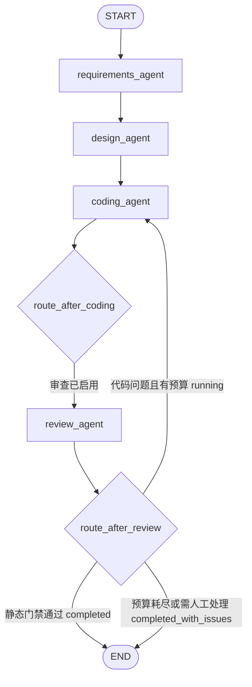
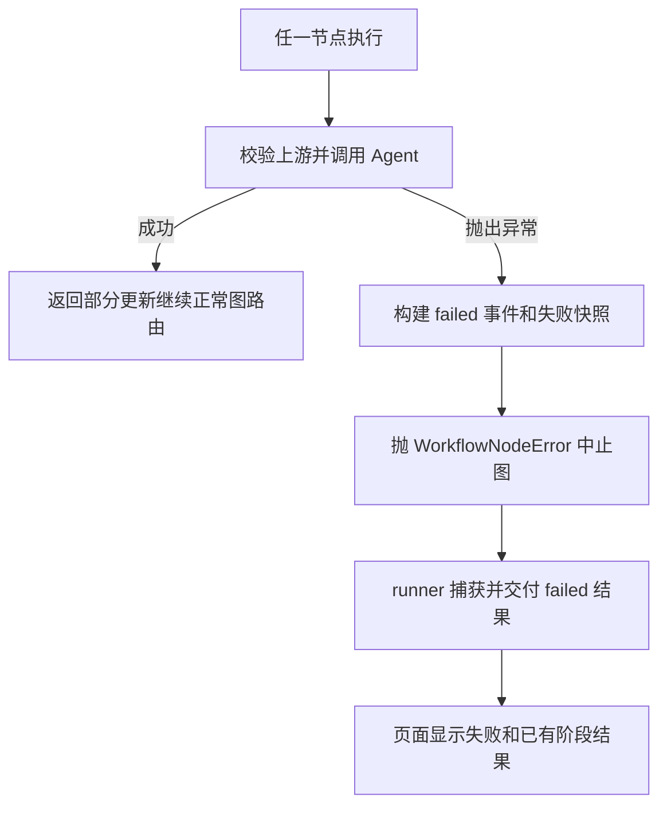

# Workflow 与 State

实现文件：src/workflow_studio/workflows/{graph,nodes,routing,runner}.py、state/{workflow,result,review}.py。

## 标准模式


build_workflow(review_enabled=False) 创建 StateGraph(WorkflowState)，用 add_node 注册三个节点、add_edge 顺序连接，再 compile。标准图不注册 Review 节点，不调用 Review Agent。

## 审查模式



本图对应 build_workflow(review_enabled=True)。菱形是 add_conditional_edges 使用的路由函数，不是额外注册的 Agent 节点。route_after_coding 在审查图正常运行时指向 Review；源码还映射 __end__ 到 END，以处理 review_enabled=False 的路由返回值，但公开 runner 会使用一致的构图/State 参数。

route_after_review 先检查终态；completed 或 completed_with_issues 返回 __end__。否则必须为 needs_revision 且 revision_count < max_revisions，才返回 coding_agent，其他情况抛状态异常。

首次生成 revision_count=0，不消耗修复预算。再次进入 Coding 时计数增加一次，即使这次修复调用失败也算已经尝试。默认 max_revisions=1，范围 0–3；只允许有预算时回环，因此业务循环有界。

ReviewRecord 保留该轮审查对象和实际被审查的代码；code 保存最新完整代码。修复时 Coding 同时读取 requirements、design、review 与上一版 code，模型返回 CodePatch；程序验证版本和权限后合并为完整 CodingOutput，再交给原节点/Review，不将局部补丁当作完整产物。

v2 判断依据为 `evaluate_review` 的程序静态门禁，不是 score 阈值或仅模型 passed。模型拒绝或存在 blocker/major 时不通过；代码问题在预算内修复，需求/设计问题或非 coding 处理建议以 `completed_with_issues` 提前结束，不消耗代码修复次数。持久模式允许用户明确选择“按审查反馈修订”，以关联的新尝试返回设计或需求澄清。旧 v1 沿用历史模型结论。

v2 审查绑定当轮 CodingOutput 及需求/设计上下文摘要。当前代码或上下文不匹配、引用未知文件/FR/AC、行号越界或引用不实会被拒绝。每轮旧审查在修复期间仍对应旧代码快照，不可作为新代码的放行依据。

## 异常路径



该图描述异常控制流，不是 graph.py 中的额外边。失败不会正常抵达下游或被 END 自动改为成功。节点内部捕获错误，_emit failed 后抛出携带快照的 WorkflowNodeError；runner 恢复该快照。其他图基础设施异常由 _infrastructure_failure 返回失败状态。

Review API 异常是 status=failed、review_status=error，不是 passed=false。正常不通过且预算耗尽、或策略要求先处理需求/设计问题时，是 status=completed_with_issues、review_status=failed，error 为空。两者必须区分。静态门禁通过始终不表示测试已执行或功能验收通过。

## 共享 State

| 字段 | 类型/初值 | 用途 |
| --- | --- | --- |
| run_id | UUID 字符串 | 一次独立运行，不可中途修改 |
| user_request | 非空字符串 | 原始需求，不可中途修改 |
| requirements / design / code | dict 或 None | 各阶段经过对应 Schema 校验的字典 |
| status | pending | pending、running、completed、completed_with_issues、failed、stopped |
| current_agent | 空字符串 | 当前或最后执行节点名；完成后不强行设为空 |
| error | None | 安全失败类别说明，不是原始 SDK 异常正文 |
| events | 新空列表 | WorkflowEvent 历史 |
| review | None | 最新有效 ReviewOutput 字典 |
| review_enabled | False | 是否启用审查 |
| revision_count | 0 | 已尝试修复次数 |
| max_revisions | 1 | 最多允许修复次数 |
| review_status | disabled / pending | 禁用时 disabled，启用时 pending |
| review_history | 新空列表 | 每轮 ReviewRecord |
| budget | None（旧记录/底层图） | 公开 runner 初始化的预算快照；包含限额、计数、用量及停止原因 |

review_status 的完整枚举为 disabled、pending、needs_revision、passed、failed、error。
TypedDict 只声明形状；运行时安全来自 channel reducer、validate_state、validate_update 和 Pydantic。State 不保存 API Key，也不保存 UI 的思考开关；后者通过任务 ContextVar 传递。

## 节点怎样更新

requirements_agent_node 读取 user_request；design_agent_node 恢复 RequirementsOutput；coding_agent_node 恢复前两个对象；review_agent_node 恢复三个对象。_execute 负责统一输入校验、计时、调用记录、输出校验和部分更新。

例如 Requirements 节点最终提交 requirements、status、budget（有运行预算时）、current_agent 和本节点两条 events，不回传所有旧事件。validate_update 会先验证合并结果，但返回的仍是部分更新；真正提交由 LangGraph 完成。

started 先通过 custom stream 发出，节点内部建立 running 快照，但中途没有向图提交一次独立 State 更新。正常返回时 started/completed 一起进入 events channel；异常时 started/failed 存在失败快照中。UI 使用 custom 事件及时显示开始，用 values 接收提交后的快照。

## 全局预算与停止

公开同步、异步及两种流式 runner 均接受 `budget: RunBudget | None` 和 `cancel_event: threading.Event | None`。budget=None 表示采用默认全局预算，不是关闭限制。直接使用 build_workflow 的底层图需自行用 `budget_scope(BudgetTracker(...))` 接入预算。

默认限额：40 次模型逻辑调用、120 次 HTTP 出站尝试、20 次格式修复、10 次节点执行、1800 秒总时限。原有单 Agent 格式上限与 max_revisions 仍有效，取先达到的边界。格式修复指 JSON 回退后的修复，或已有有效原生对象但一致性/引用失败后的重试；仅从“不支持结构化输出”转为 JSON 的首次回退不计格式修复，但会消耗逻辑调用。

`stopped` 是独立终态：error=None，budget.stop_reason 必须存在。它与 failed、completed_with_issues 分开，不能显示为成功。停止前已有的合法需求、设计、代码和审查快照保留；最后一次调用已经返回且通过输出校验时，也会保留它的结果。节点/模型准入前拒绝的动作不执行；节点未准入时不增加代码修复次数。

预算原因包括 logical_calls、http_attempts、format_repairs、node_executions、deadline、tokens、repeated_review；cancelled 表示用户请求。每次节点/模型/HTTP 准入及节点完成边界检查取消与时限；同步调用或 SDK 退避可能超出墙钟时限后才到达下一边界。HTTP 各阶段 timeout 会压缩到发出时剩余时限，但不是整个调用的硬 deadline。

可选 `max_total_tokens` 是按逻辑调用预留/结算的核算上限。每次调用先预留 tokens_reserved_per_call（默认 32768），有可靠总用量时用实测替换；否则保留预留并标记 unknown。预留不是实测值，不把缺失用量当零；实际用量可能超过预留，此时保留结果并在下一边界停止。该功能不是严格物理 token 上限或费用保证，不能推断 SDK 各次失败重试的计费用量。

可选 `max_repeated_reviews>=2` 默认未启用。它对连续待修复的 v2 结构化问题做精确指纹比较，忽略当轮问题 ID 和列表顺序；达到阈值则停止。文字、位置或关联改变会视为不同问题，不做语义相似推断；v1 无结构化问题时不适用。

预算配置运行中不可更改，调用/节点/时间等累计字段不得回退。运行时对象通过 ContextVar 和锁隔离，State/存档只保存快照。流式接口在 yield 给调用方前恢复上下文，避免多个消费者之间泄漏预算。

```python
from workflow_studio.budget import RunBudget
from workflow_studio.workflows import run_workflow

# 此示例是实际业务入口，执行会调用 API；不是离线测试。
result = run_workflow(
    "使用 Python 标准库实现整数加法工具。",
    review_enabled=True,
    budget=RunBudget(max_logical_calls=12, max_http_attempts=24,
                     max_elapsed_seconds=600, max_repeated_reviews=2),
)
print(result.status, result.budget)
```

事件包含 event_id、run_id、UTC 时间、Agent、类型、状态、节点耗时、输入/输出字段名、revision_count、LLM 调用记录和可获得 token usage。状态指工作流状态：Requirements completed 事件可以同时带 status=running，不等于整图完成。

merge_events 按 ID 合并，不修改原列表；相同逻辑事件重复投递不重复记录。同 ID 比较除 timestamp 外的内容，冲突拒绝。前端收到 custom 与 State 中的同一事件时也使用该 reducer。审查历史用独立 record_id 去重。

## 完整 State 变化示例

以下是用于学习的固定 Mock 数据，不是真实 DeepSeek 响应或性能结果。使用标准模式，run_id 为本次创建的同一个 UUID。

| 时刻 | status | current_agent | requirements | design | code | 事件数 |
| --- | --- | --- | --- | --- | --- | --- |
| 初始化 values | pending | 空 | None | None | None | 0 |
| Requirements started custom | running（事件） | requirements_agent（事件） | 尚未提交 | None | None | UI 先看到 1 条 |
| Requirements 提交 values | running | requirements_agent | R | None | None | 2 |
| Design 提交 values | running | design_agent | R | D | None | 4 |
| Coding 提交 values | completed | coding_agent | R | D | C | 6 |

R、D、C 对应下例构造的完整模型。贯穿全程：user_request 不变、error=None、review=None、review_enabled=False、revision_count=0、max_revisions=1、review_status=disabled、review_history=[]。初始化本身不自动添加 initialized 事件。

### 可运行的离线示例

安装项目后，将此代码保存到独立练习文件运行。它执行真实 StateGraph，只 Mock 三个 Agent，不调用 API、不执行生成的 add 函数、不保存运行历史。

```python
from unittest.mock import patch
from workflow_studio.state import RequirementsOutput, DesignOutput, ModuleDesign, CodingOutput, CodeFile
from workflow_studio.workflows.runner import stream_workflow

request = "使用 Python 标准库开发整数加法工具，并提供运行说明。"
r = RequirementsOutput(
    project_name="加法工具", summary="计算两个整数之和",
    functional_requirements=["计算两个整数之和"],
    non_functional_requirements=[], constraints=["仅 Python 标准库"],
    assumptions=[], acceptance_criteria=["2 与 3 的结果为 5"],
)
d = DesignOutput(
    architecture_overview="单个 Python 函数", technology_stack=["Python 标准库"],
    modules=[ModuleDesign(name="calculator", responsibility="实现整数加法",
                          dependencies=[], requirement_ids=["FR-1"])],
    data_models=[], interfaces=["add(a, b) 返回整数和"],
    project_structure="calculator.py", design_decisions=["最简单的单模块方案"],
    preserved_constraints=r.constraints,
)
c = CodingOutput(
    files=[CodeFile(path="calculator.py", language="python",
                    content="def add(a: int, b: int) -> int:\n    return a + b\n",
                    description="整数加法函数")],
    instructions="保存文件后可手动导入 calculator.add；此示例未执行。",
    dependencies=[], test_suggestions=["手动验证 add(2, 3) == 5"],
    limitations=["生成代码未执行，未提供测试文件"],
)
with patch("workflow_studio.workflows.nodes.analyze_requirements", return_value=r), \
     patch("workflow_studio.workflows.nodes.design_system", return_value=d), \
     patch("workflow_studio.workflows.nodes.generate_code", return_value=c):
    states = list(stream_workflow(request))

assert [s["status"] for s in states] == ["pending", "running", "running", "completed"]
assert [len(s["events"]) for s in states] == [0, 2, 4, 6]
assert len({s["run_id"] for s in states}) == 1
assert states[-1]["requirements"] == r.model_dump(mode="json")
assert states[-1]["design"] == d.model_dump(mode="json")
assert states[-1]["code"] == c.model_dump(mode="json")
print([(s["status"], s["current_agent"], len(s["events"])) for s in states])
```

审查失败后修复一次并通过的补充轨迹：首次 Coding → running/pending/0 → Review 不通过 running/needs_revision/0（history=1）→ 再次 Coding running/pending/1 → Review 通过 completed/passed/1（history=2）。预算耗尽仍不通过则最后为 completed_with_issues/failed，不能标成审查通过。

## 对外入口和完成信号

run_workflow 返回 WorkflowResult；arun_workflow 提供异步图入口；stream_workflow 返回 State 快照；stream_workflow_events 返回 custom/values 包。compiled graph 自身还提供 stream/astream，但 UI 没有使用 token 级流式输出。

_worker 在流结束后发 WorkerFinished；_finish 仅接受明确终态。没有合法终态时标记失败。单次失败不改变下一次 create_initial_state 的数据；本地保存失败也不改写已经得到的业务终态。

## 可选持久模式

`workflows/durable.py` 提供 `create_durable / inspect_durable / list_durable / stream_durable / execute_durable / aexecute_durable / fork_durable_attempt`。首次创建仅保存起点，执行、恢复和分叉必须携带 `expected_checkpoint_id`。`DurableView.result` 仅在终态存在；`waiting` 的 State 与问题保存在 checkpoint，而非包装成 WorkflowResult。

该图在 Requirements 后增加 `clarification_prepare`：无待答阻断问题则进入 Design，否则进入 `clarification_gate` 并调用原生 `interrupt`。提交答案通过 `Command(resume=...)` 唤醒 gate，保存问答后重新运行 Requirements。控制节点也计入节点预算；等待不扣新的模型调用，已回答的相同问题不重复阻断，最多默认三轮澄清。

逻辑 session/thread ID 对应多个尝试；原生崩溃恢复使用当前 attempt/run，失败重试和明确修订则分配新的 attempt/run，保留父尝试及其终态。设计修订丢弃原代码与审查；需求修订还丢弃原设计并先请求澄清。累计预算独立于图状态记录，不因分叉清零。

```python
from workflow_studio.storage.checkpoints import CheckpointStore
from workflow_studio.workflows.durable import create_durable, execute_durable

store = CheckpointStore()
try:
    view = create_durable(store, "使用 Python 标准库提供整数加法。")
    view = execute_durable(store, view.thread_id, expected_checkpoint_id=view.checkpoint_id)
    # waiting 时先展示 view.state["awaiting_questions"]；用户回答后再显式提交。
    # execute_durable(store, view.thread_id, expected_checkpoint_id=view.checkpoint_id,
    #                 answers={"Q-1": "用户实际回答"})
finally:
    store.close()
```

示例中的 execute 会调用已配置模型。恢复只承诺已提交 checkpoint 的继续执行，未提交节点可能重放；不会保证模型调用或其他外部副作用恰好一次。等待/离线时间排除在累计执行时间外，在途未知调用保留预算预留；未知工作流版本、并发占用及过期命令均拒绝执行。

## 独立固定验收流程

`WorkflowResult（完整产物） → 用户选定固定接口 → validate_artifact → ValidationReport → 独立质量判断/存档`。验证是显式的生成后操作，状态不回写既有图终态。即使模型静态通过，执行失败、环境错误、超时或 not_run 均不能获得验证通过；反过来固定接口通过也不能消除未解决的静态阻断问题。

```python
from workflow_studio.validation import validate_artifact, validation_quality
from workflow_studio.validation.store import ValidationStore

# result 为已有终态 WorkflowResult；此调用会尝试使用已配置本机容器。
report = validate_artifact(result, "add-cli")
quality = validation_quality(result, report)
ValidationStore().save(report)
```

默认仅支持 Python 标准库、小项目 `main.py`、一个 JSON 输入和一个 JSON 输出。不兼容接口返回 not_run，禁止猜测用户入口、执行生成的 shell/pytest 配置或自动安装依赖。静态 import 检查用于提前发现已声明/明显的第三方依赖，不能分析任意动态导入；镜像本身仍须审核为受支持运行环境。

每次验证有独立 `ValidationLimits`：默认单例 5 秒、总执行 60 秒、最多 16 例、每输出流 16 KiB；首版没有自动基础设施重试或费用调用。这项独立操作不重置生成工作流预算，也不消耗其模型额度。超时和取消需额外的有限 CLI 退出/容器清理时间，清理最多等待 5 秒，服务不会承诺绝对硬 wall-clock 上限。应用进程被强制终止时 finally 可能无法清理，应由管理员检查 `workflow-validation-*` 容器；未实现跨进程验证任务恢复或守护清理。

若需要模型结合证据审查，可显式调用 `validation.review.review_validated(result, report)`；它在任何模型请求前拒绝旧证据，将结构化报告提供给 Review，并返回绑定报告摘要的联合结果。Review 自身仍只给静态意见，联合 accepted 要求运行完成、固定验收 passed 且静态门禁通过；LLM 无权覆盖报告。此函数会调用模型，使用原有有限格式修复；需要统一模型预算的调用方应置于 `budget_scope`。页面默认验证和评测 CLI 均不调用模型。

固定评测 `python-cli-acceptance-v1` 包含 10 项任务、9 项自动任务的 23 个用例与 1 项人工冲突任务。CLI 接收预生成 `<suite-id>.json` CodingOutput，并对每项建立明确的固定评测上下文；不把它当作真实 LLM 的需求输出。评测任务缺失、人工项、错误、超时都保留在 10 项分母中，同时报告可自动任务数，禁止只对成功执行的子集报告通过率。整次评测最多运行 300 秒，取消/超时清理有额外开销；记录数据集版本和完整摘要。题目或期望变化应升级版本，不通过调整题目掩盖实现回归。

## 增量补丁与验证回归

普通/持久审查图保留原节点与最多 0–3 次代码修复循环。首次生成仍用完整 CodingOutput；后续 generate_code 在适配器内生成并原子应用 CodePatch，再向节点返回完整产物。默认只允许替换已有文件，所有更改必须明确列入 changes、带已知问题编号并匹配代码/上下文/反馈摘要；未知操作、旧补丁、大小写改名、未授权新增/删除、无效 Python、空替换与合并后的路径冲突/超限均拒绝。失败不修改输入对象或宿主文件，预算停止可保留已校验的新代码与修复收据。

`WorkflowEvent.repair_receipt` 为兼容的可选字段。旧事件读取默认为 null，旧存档幂等保存不改原字节；带收据的结果在加载时与上一轮 ReviewRecord 的基线、反馈、真实差异及当前/历史结果核对。收据经 checkpoint 序列化，后续恢复继续使用原调用/修复预算。它记录的是应用过的文件变更，不是运行测试成功证明。

```python
from workflow_studio.agents.coding_agent import generate_code
from workflow_studio.state.patch import RepairPolicy

# 此调用会访问模型；req/design/review/previous 为已有且版本一致的对象。
policy = RepairPolicy(replace_paths=("main.py",), create_paths=(), delete_paths=())
fixed = generate_code(req, design, previous_code=previous,
                      review=review, repair_policy=policy)
```

独立验证修复入口为 `validation.repair.repair_and_validate(result, suite_id, ...)`，仅供显式业务调用，普通 Web 验证按钮与评测 CLI 不自动调用模型。流程先对源产物运行完整固定验收，仅 failed 可触发修复；为每个新版分配新 run_id，保留父子关系和独立报告。每次修复后重新跑所选完整固定集，代码变化立即使旧报告失效，不沿用旧通过证据。新版不继承旧静态审查，固定验收通过仍需另行 Review 才能作联合判断。

```python
from workflow_studio.validation.repair import repair_and_validate

# 明确可能调用模型、使用已部署隔离后端；本机无后端时为 not_run。
delivery = repair_and_validate(result, "add-cli", max_repair_rounds=1)
print(delivery.status, delivery.metrics)
```

入口默认最多一轮，配置 0–3 且不能超过源运行剩余业务修复次数；有源预算时继承且拒绝覆盖，固定验收与每次修复都消耗节点/实际执行时间，模型格式修复继续计入统一调用额度。新版携带已消耗的额度和剩余业务修复次数。此入口管理自己的顶层 budget_scope，不允许嵌套另一运行预算；原始结果、原持久会话与原终态存档不被回写。每次显式操作的完整收据/父子链由返回对象交付，独立报告自动存档；新版代码和收据需调用方另行保存。没有持久化这项独立编排的执行现场，进程崩溃后不能把它当作可原生恢复的图。

回归仅在验收集摘要、环境、完整用例集合一致且结果可比较时计算，记录“原先 passed、现在 failed”的用例；有回归即停止并保留失败新版，不自动宣布修复成功。环境变化、错误、超时或不完整报告时为不可比较（None），不记为零回归。无后端/未运行不触发模型，需求/设计人工问题不因验证失败变成自动 Coding；取消/额度不足以 stopped 交付。已生成但尚未再验收的合法代码以 pending_candidate/pending_receipt 保留，没有伪造新报告或旧证据复用。

效率指标为输入文本字节、规范化补丁/合并产物字节、成功补丁的格式失败次数、已返回真实 token 与未知用量计数。修复输入仍完整保留需求、设计接口与代码，未引入语义摘要、缓存或依赖猜测裁剪；补丁较小不证明真实费用或端到端时延下降，小产物补丁甚至可能更大。
